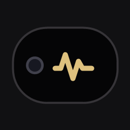

<div align="center">
  
  <h1>Notchy</h1>
  <p><strong>A lightweight Windows desktop companion with a Dynamic Island-inspired interface.</strong></p>
  <p>
    
    
    
    
  </p>
</div>

Notch places a transparent, frameless island at the top of a selected display, bringing system controls and everyday desktop tools into one compact interface. Hover over or click the island to expand it, or use **Ctrl+Shift+Space** to toggle it.

> **Project status:** Notch is under active development. Windows integrations depend on the device, driver, Windows policy, and current session; unsupported controls are reported as unavailable.

## Contents

- [Features](#features)
- [Requirements](#requirements)
- [Getting started](#getting-started)
- [Build](#build)
- [Release notes](#release-notes)
- [Architecture](#architecture)
- [Privacy and local data](#privacy-and-local-data)
- [Known limitations](#known-limitations)
- [Troubleshooting](#troubleshooting)
- [Contributing](#contributing)
- [License](#license)

## Features

### Windows controls

- Windows master-volume control through Core Audio.
- Display brightness control when the active display supports the Windows monitor WMI interface.
- A single Wi-Fi tile opens an in-notch panel for radio control, nearby networks, saved connections, and password entry (including a show/hide control) for supported personal-security networks. A Windows native addon uses the WLAN API and Windows Runtime; connection status is verified without launching PowerShell, `netsh`, or Windows Settings.
- A single Bluetooth tile opens an in-notch panel for radio control, nearby-device discovery, pairing, and paired-device connection status through the Windows Runtime native addon. Windows may request confirmation during pairing and manages per-device connection profiles.
- Windows media-session integration where a compatible session is available.

### Desktop tools

- CPU, GPU, memory, disk, network activity, and top-process metrics.
- Text clipboard history with configurable size and retention limits.
- Start menu application discovery, pinned applications, and an application picker.
- Wallpaper previews, local image imports, and applying an image as the Windows desktop wallpaper.
- Calendar, local tasks and reminders, and Windows notifications while Notch is running.
- Lock, sleep, restart, and shutdown actions; restart and shutdown require confirmation.

### Customization

- Dark and light themes, display selection, and time format.
- Global shortcut, startup preference, always-on-top, and click-through settings.
- Monitoring interval and clipboard-history settings.
- System tray controls and a compact music preview with locally generated audio.

## Requirements

- Windows 10 or Windows 11.
- Node.js **22.12.0 or newer** and npm.
- Visual Studio Build Tools with **Desktop development with C++** and a Windows 10/11 SDK, required to compile the native wireless addon.

## Getting started

Clone the repository and install the exact dependency versions recorded in the lockfile:

```powershell
git clone https://github.com/JemxProgramz/Notchy.git
cd Notchy
npm ci
npm run check
npm run dev
```

`npm run check` validates JavaScript syntax, package metadata, renderer/native-addon wiring, and the Windows icon. The `dev`, `start`, and build commands compile the Windows addon automatically.

## Build

Create the Windows NSIS installer and portable executable:

```powershell
npm run build
```

Other build targets:

```powershell
npm run build:dir     # Unpacked application directory
npm run build:appx    # Optional, locally signed AppX package
```

Build output is written to `Build-test/` and is excluded from version control. The optional AppX package and its installer helpers are written to `Build-test/appx/`.

To compile the addon on its own, run `npm run build:native`. It uses stable Node-API and Windows WLAN/Windows Runtime APIs; no PowerShell or `netsh` process is used for Wi-Fi or Bluetooth operations. The compiled `.node` file is shipped as a native resource alongside Electron's ASAR archive.

The AppX build creates a temporary self-signed signing certificate and removes its private key after the build. The generated certificate and package are local build artifacts. Windows requires trusting the certificate to install that package. The certificate is for local development and evaluation, not public distribution.

The NSIS installer is configured not to require administrator privileges by default. Public installer signing and update delivery require a publisher identity and release infrastructure; Notch does not currently include an update service.

## Release notes

### v1.0.0

- Initial Notchy release for Windows 10 and 11.
- Added the Dynamic Island-inspired desktop interface, system tray, global shortcut, and customization settings.
- Added Windows system controls, desktop metrics, clipboard history, wallpaper tools, app launcher, calendar, tasks, and reminders.
- Added Windows NSIS installer, portable executable, and optional locally signed AppX build.

Downloadable builds are published through GitHub Releases when available. Build locally using the [build instructions](#build).

## Architecture

Notch is an Electron application. The main process owns Windows integrations and application lifecycle; the renderer implements the interface; a restricted preload exposes the approved IPC surface to the renderer.

```text
src/
+-- main.js                         Main-process startup and shared Windows services
+-- preload.js                      Restricted renderer IPC bridge
+-- media.ps1                       Windows media-session helper
+-- pages/
|   +-- index.js                    Page IPC registration
|   +-- controls/
|   |   +-- renderer/index.js       Controls UI: Wi-Fi, Bluetooth, brightness, volume, night light, theme
|   |   +-- main.js                 Controls IPC registration
|   |   +-- wifi/main.js + native/wifi.cc
|   |   +-- bluetooth/main.js + native/bluetooth.cc
|   |   +-- brightness/main.js
|   |   +-- volume/main.js
|   |   +-- wireless/main.js + native helpers
|   |   +-- audio/native/            Windows output-level capture
|   |   `-- windows-settings/main.js
|   +-- today/
|   |   +-- renderer/index.js       Clock, weather, timer, task list, calendar
|   |   +-- main.js
|   |   +-- task/main.js            Native reminder notifications
|   +-- stats/
|   |   +-- renderer/index.js       CPU, GPU, memory, network, processes, storage
|   |   +-- main.js
|   +-- clipboard/                  renderer/index.js and main.js
|   +-- apps/                       renderer/index.js and main.js
|   +-- wallpaper/                  renderer/index.js and main.js
|   +-- power/                      renderer/index.js and main.js
|   +-- settings/                   renderer/index.js and main.js
+-- renderer/
|   +-- index.html                  Interface markup and script order
|   +-- app.js                      Shared UI state and core interactions
|   +-- integrations/windows.js     Cross-page Windows integration
|   +-- bootstrap.js                UI initialization
|   +-- styles.css                  Shared UI styles
|   +-- native.css                  Windows integration styles
+-- native/
|   +-- binding.gyp                 Native addon build configuration
|   `-- build/                      Generated, ignored node-gyp output
assets/                              Application icons
build/appx/                          AppX package logos
scripts/                             Validation, build, and install helpers
```

Page code lives together under `src/pages/<page>/`: each page keeps its renderer module and Electron main-process handlers side by side. Controls groups Wi-Fi, Bluetooth, brightness, volume, night light, and notch theme; Wi-Fi and Bluetooth native C++ sources sit in their feature folders. Today groups clock, weather, timer, tasks, and calendar; Stats groups CPU, GPU, memory, network, top processes, and storage; Wallpaper groups Recent and My folder.

The `src/renderer/` directory contains the shared UI shell and cross-page Windows integration. `src/native/binding.gyp` builds the feature-local C++ sources into `src/native/build/`; that generated directory stays ignored. `src/main.js` owns application lifecycle and shared Windows services, while `src/preload.js` exposes the restricted IPC bridge.

Renderer scripts load in dependency order from `renderer/index.html`. The shared shell initializes page UI, while `renderer/integrations/windows.js` connects page features to Electron and Windows APIs.

## Privacy and local data

- Notch has no account or cloud service and does not send clipboard contents or system metrics to a server.
- Settings and clipboard history are stored in Electron's per-user `userData` directory.
- Tasks, reminders, pinned applications, and wallpaper-selection metadata use Notch's local Chromium storage.
- Clipboard monitoring can be disabled in Settings. When enabled, text clipboard history is collected locally while Notch is running; history can be cleared in Settings.
- The external media visualizer reads live output levels from the Windows audio loopback while a media session is playing. Notch keeps only a short in-memory sample window and does not record or save audio.
- Obvious password, token, and private-key text is skipped. This is a best-effort filter, not a guarantee that every sensitive string will be detected.
- Clipboard image history is not implemented. Notifications are delivered only while Notch is running.

## Known limitations

- Brightness adjustment depends on the active display and driver exposing Windows' monitor WMI interface; many external monitors do not.
- GPU utilization is shown only when the installed driver exposes a usable reading. Notch does not estimate missing values.
- Wi-Fi discovery, radio control, saved-profile connection, and supported personal-network setup use the Windows WLAN and Radio APIs through the native addon. Enterprise authentication modes are not configured by Notch.
- Windows owns per-device Bluetooth connection behavior. Notch can toggle the radio, discover and pair devices in the notch, and report a paired device's connection status; individual audio/input connection profiles remain managed by Windows.
- Media controls depend on a compatible Windows media session being active.
- External media visualization depends on Windows providing an active default multimedia output device; without it, playback controls still work and the visualizer stays idle.
- Display, power, and system-control behavior may be restricted by Windows policy or a remote session.

## Troubleshooting

| Issue | What to try |
| --- | --- |
| The island is hidden | Open Notch from the system tray or press **Ctrl+Shift+Space**. |
| The global shortcut is unavailable | Choose another shortcut in Settings; another application may already have registered it. |
| Brightness is unavailable | Check whether the active display and driver expose Windows monitor brightness controls. |
| GPU utilization is missing | Check driver telemetry support; unavailable readings are not estimated. |
| A wallpaper is not applied | Check Windows desktop-background policy and use a PNG, JPEG, or BMP image. |
| Wi-Fi networks do not appear | Turn on the Wi-Fi radio and refresh the in-app network list. Scanning depends on Windows WLAN services and driver support. |
| Bluetooth pairing or connection status is unavailable | Confirm Bluetooth is on and the device is discoverable. Windows may require confirmation and manages per-device connection profiles. |
| The native addon build reports that Visual Studio is missing | Install Visual Studio Build Tools with the **Desktop development with C++** workload and a Windows 10/11 SDK, then run `npm run build:native`. |
| A build cannot replace `Notch.exe` | Close running Notch instances from the project's `Build-test/` folder, then retry. |

## Contributing

Bug reports and focused pull requests are welcome. Before submitting a change:

1. Keep changes scoped and describe the user-visible impact.
2. Run `npm ci` and `npm run check`.
3. For Windows-specific changes, include the Windows version and relevant device or driver details in the report.
4. Do not include build artifacts, local wallpaper files, credentials, signing certificates, or personal data.

## License

This project currently declares `"license": "UNLICENSED"` in `package.json` and does not include an open-source license. **Do not assume that the source may be reused, modified, or redistributed.** Choose and add a license before inviting external contributions under open-source terms.
